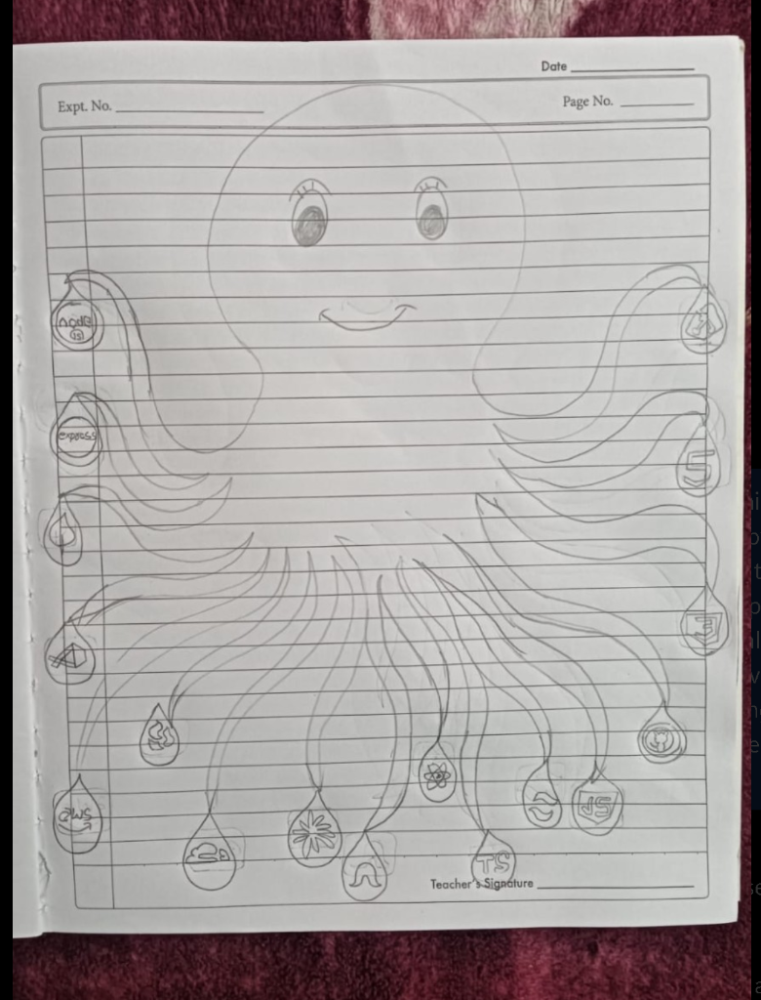

# 🐙 The KRAKEN Portfolio • Distributed Systems Architecture

> An interactive, living, organic, and calming underwater digital twin of distributed backend engineering systems, inspired by a hand-drawn notebook sketch.



---

## 🌊 Overview & Story

Standard developer portfolios are static grids of cards. **The Kraken** reimagines the developer portfolio as a living, organic digital creature swimming through deep abyssal waters.

Inspired directly by a hand-drawn notebook sketch created by the developer's girlfriend, the Kraken sits at the center of the deep sea. It breathes with gentle sinusoidal buoyancy, blinks every 3–5 seconds, tracks your cursor gaze across the viewport, blushes with floating hearts when petted, and holds **11 bioluminescent teardrop tech orbs** on curling procedural tentacles.

Each tech orb represents a critical distributed engineering system, featuring real-world production metrics, architectural flows, and zero-bullshit systems proofs targeted for **50+ LPA / US Remote Backend & Systems roles**.

---

## ⚡ Key Highlights & Architecture

| Feature | Engineering Implementation | Benefit |
| :--- | :--- | :--- |
| **Living Procedural Tentacles** | Mathematical cubic Bézier curves (`C cp1x cp1y, cp2x cp2y, x y`) with dynamic normal vector displacement for suction cups | 120 FPS fluid motion, 0 KB 3D model overhead, zero WebGL jank |
| **Abyssal Ocean Environment** | HTML5 `<canvas>` simulation with 45 rising micro-bubbles, marine snow dust, and refracted caustic light cones | Calming, immersive atmosphere running strictly off the main thread |
| **Live Cloud Telemetry** | Real-time health probe actively polling `https://yourvaultstorage.com/api` measuring round-trip latency (ms) & TLS status | Proves active production systems live to recruiters |
| **Web Audio Synthesizer** | Pure Web Audio API (`AudioContext`) oscillator sweeps with exponential gain decay envelopes | Warm bubble pops and harmonized chimes with **0 MB audio files downloaded** |
| **Recruiter Fast-Track** | Glassmorphic slide-out executive brief, 1-click resume download with celebratory oceanic confetti burst | Instant answers for technical recruiters and hiring managers |
| **Personality & Easter Eggs** | Sleep mode after 32s inactivity (closed eyes + "Zzz" bubbles), double-click wink, head-click blushing with hearts | Memorable, delightful UX that recruiters talk about |

---

## 🛠️ Tech Stack & Systems Showcased

- **Frontend Core:** React 19, TypeScript, Vite, Tailwind CSS v4, Framer Motion, Lucide Icons.
- **Backend & Cloud Systems Showcased:**
  - **Node.js & TypeScript:** Event-loop non-blocking I/O, cluster worker pools, streaming pipeline transformations.
  - **AWS S3 & Cloudflare Workers:** Direct browser-to-S3 multipart upload presigned URLs, Cloudflare edge HMAC tokens ($0 egress fees).
  - **Redis:** Distributed caching, cluster token buckets, sliding window rate limiters, session locks.
  - **PostgreSQL & MongoDB:** B-tree index tuning, transaction isolation, sharded replica sets.
  - **Docker & Linux:** Multi-stage scratch containers, PM2 cluster processes, systemd automation.
  - **JWT & Cryptography Lab:** Security exploit testbed mitigating algorithmic confusion (RS256 vs HS256) and replay attacks.
  - **CI/CD Pipeline Engine:** Self-hosted GitHub webhook daemon with HMAC signature validation and zero-downtime hot reloads.

---

## 🎮 Interactive Controls & Easter Eggs

- **Hover Tech Orb:** The tentacle dynamically curls upward, the Kraken opens its mouth in delight ("Oh!"), and the eyes fixate on the orb.
- **Click Tech Orb:** Opens the tabbed **Architectural Project Showcase Drawer** with system topology diagrams, design decisions, and live project buttons.
- **Category Filter Bar:** Filter by `Backend`, `Cloud`, `Database`, `Security`, or `Frontend`—non-matching tentacles smoothly dim to 25% opacity.
- **Click Kraken's Head:** Triggers a warm blush across the mantle and spawns glowing rosy heart particles.
- **Double-Click Eyes:** The Kraken winks at you playfully and rings a sweet harmonic chime.
- **32-Second Inactivity:** The Kraken peacefully falls asleep, closing its eyes while animated cyan "Zzz" bubbles drift upward. Move cursor or tap to wake.
- **Audio Toggle:** Tap the sound pill in the header to unmute the procedural sound engine.

---

## 🚀 Getting Started Locally

```bash
# 1. Clone repository
git clone https://github.com/adarshbam/kraken-portfolio.git
cd kraken-portfolio

# 2. Install dependencies
npm install

# 3. Start development server
npm run dev

# 4. Build for production
npm run build
```

---

## 🌐 1-Click Production Deployment

### Option A: Vercel (Recommended)
```bash
npx vercel
```

### Option B: Netlify
```bash
npx netlify deploy --prod
```

### Option C: Cloudflare Pages
1. Push to GitHub.
2. Connect your repo in Cloudflare Pages dashboard.
3. Build command: `npm run build`
4. Output directory: `dist`

---

## ❤️ Tribute

Engineered with love and care based on the original hand-drawn notebook sketch created by my girlfriend. Click the "Girlfriend's Drawing" button in the bottom status bar or header to compare the live app with her original artwork.
