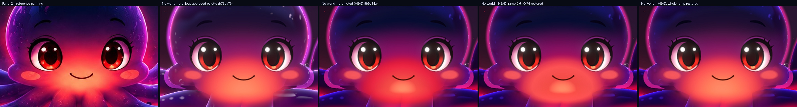
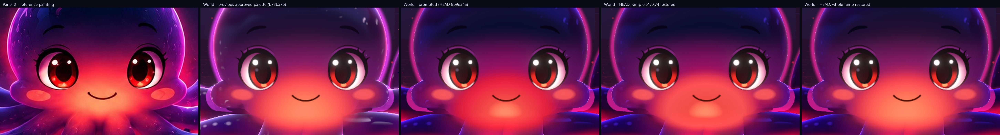

# Nox world, physics and motion review log

Spec: `docs/superpowers/specs/2026-10-26-nox-world-and-motion-design.md`. Plan: `docs/superpowers/plans/2026-10-26-nox-world-and-motion.md`.

Each milestone ends with the owner's live review. The owner's words, the date and any kept stills are recorded here before the milestone is committed, and the next milestone starts only after approval. Stills only: no clips or frame sequences (see the plan's milestone review pattern). Captures are under `assets/` when kept.

| Milestone | Date | Owner verdict | Capture |
|---|---|---|---|
| 1. Nox's look in the world | pending | | |
| 2. The world in production | pending | | |
| 3. Water physics for the arms | pending | | |
| 4. The back view | pending | | |
| 5. Swimming and the entrance | pending | | |
| 6. Technology bubbles | pending | | |
| 7. The head swell | pending | | |
| 8. Shared micro-animations and variant hooks | pending | | |
| 9. Pass across every stage | pending | | |
| **Phase sign-off** | pending | | |

## Measurements

### The world colour check (Task 1, 2026-10-26)

`node scripts/world-capture.mjs <stage> <out.png>` captures the frozen stage at the high-quality panel 2 framing (1536 x 1024), so a capture pixel is a panel pixel, plus `<out>-mask.png`. `python scripts/check_stage.py <out.png> --world [--stage intro]` measures the mean colour, mean per-pixel HSV saturation and brightness inside the silhouette, and (for `--stage intro`) CIE76 delta E of 7 x 7 px patches at the eight points in `scripts/world_samples.json`. Targets: mean (119, 23, 79) within 10 per channel, saturation 0.85 to 0.91, brightness 0.49 to 0.57, delta E at most 8.

Calibration on known images:

| Image | Mean RGB | Saturation | Brightness | Result |
|---|---|---|---|---|
| Panel 2, through the registered capture mask | 118, 26, 89 | 0.867 | 0.538 | PASS (blue 89.07 is on the 10 tolerance edge; checked as the whole 8-bit colour) |
| Approved stage (painted plate), through its own mask | 138, 41, 95 | 0.758 | 0.580 | FAIL, as expected (spec: 137, 41, 95 / 0.76 / 0.58) |

How the panel 2 measure works. The measurement uses the registered capture mask: the view box frames exactly the painting, so a capture pixel is a panel pixel, and the mask is used exactly as captured for the render and for panel 2. Registered, panel 2 reads (118, 26, 89), 0.867, 0.538. The spec's (119, 23, 79) came from an older stage-capture mask that was misregistered by about (16, -14) px (checked by edge alignment: this mask fits the painting best at shift (-2, 0), the old one at (16, -14)). The targets are kept as approved and panel 2 passes them. The mean colour is compared as the whole 8-bit colour it prints as, so panel 2's blue (89.07) sits on the 10 tolerance edge and passes.

Region points (world x, y; HQ px = 783.6 + 204.5 x, 495.4 - 204.5 y). Each lies at least 4 px inside the approved-stage mask and in the same feature on panel 2, except `aura outside`, which lies 8 px outside the mask above the head. The four arm points lie on the lower right arm, one cross-section through the rim, the top surface, the red band and a cup.

| Region | World point | HQ px | Panel 2 | Approved stage | Delta E |
|---|---|---|---|---|---|
| head crown | 0.00, 0.06 | 784, 483 | #041145 | #231649 | 6.9 |
| head middle | 0.00, -0.10 | 784, 516 | #010a2d | #181238 | 8.2 |
| cheek glow | -0.49, -0.85 | 683, 669 | #fb494d | #f7575f | 10.0 |
| upper arm top | 1.50, -1.10 | 1090, 720 | #3d0348 | #550b5b | 9.3 |
| arm underside band | 1.40, -1.17 | 1070, 735 | #d2053a | #9e0644 | 27.3 |
| arm rim | 1.40, -1.03 | 1070, 706 | #a76de3 | #79339a | 22.8 |
| suckers | 1.40, -1.221 | 1070, 745 | #fc7b56 | #fb7152 | 4.2 |
| aura outside | 0.00, 0.295 | 784, 435 | #381750 | #473365 | 12.4 |

The approved stage misses six of the eight regions, which is the starting point for milestone 1.

### Nox's accents in the world (Task 3, 2026-10-27)

The skin shader now carries the world's accents as compiled code (`character/worldAccent.ts`): warmth from the eight world lights nearest Nox on the sides and underside, the surface light's caustics on up-facing skin, and a far haze that is exactly 0 within 18 units of the camera (density 0 for now). Warmth is capped at 10% of the skin's own luminance, caustics at 5%, and both together at 10%. Each is capped first and faded by its mask after, so the fades hold however strong the light. The face, the crown and the neon rim take no warmth; the rim takes no caustics; nothing reaches the face glow where the arms join the body. The rim fade runs over n·v 0.6 to 0.8: the arm's neon rim is still a fifth of its colour at 0.6 and a twentieth at 0.7. Every strength defaults to 0. In a world, Nox casts the surface light's shadow (a soft band on the seabed in front of him, just below panel 2's frame).

**No change without a world.** `stage-capture intro` then `check_stage --panel 2`, before (HEAD 13aa17f) and after: PASS both, the same ten colour deltas (12, 14, 6, 16, 12, 1, 15, 5, 10 or 9, 4) and the same four widths. The one moving value, `bg upper-left` (10 or 9), reads both ways on two HEAD captures: bubbles and embers run on the real clock. Inside Nox's silhouette the mean colour matches HEAD within 0.01 per channel; the few pixels that differ by more than 8 are a bubble passing the arm junction.

**In the world** (`world-capture intro`, `check_stage --world --stage intro`). The starting strengths are the test scene's warmth balance at 0.05 of its strength and caustics at 0.005 of the surface light. At the test scene's full strength the warmth sat on its cap over most of each arm (a flat 10% lift, no falloff from the lights); at 0.05 the cap binds on almost no pixels and the warmth falls off from the lava corners.

| Capture | Mean RGB | Saturation | Brightness |
|---|---|---|---|
| Spec row: test scene, Nox unlit by the world | 138, 42, 97 | 0.75 | 0.58 |
| HEAD 13aa17f (no accents, no shadow) | 137, 41, 94 | 0.753 | 0.576 |
| Accent strengths 0, shadow on (control) | 137, 41, 94 | 0.753 | 0.576 |
| Starting accents, run 1 | 137, 41, 94 (137.34, 41.37, 94.43) | 0.752 | 0.577 |
| Starting accents, run 2 | 137, 41, 94 (137.34, 41.38, 94.43) | 0.752 | 0.577 |

Both runs are no worse than the unlit row on every measure. Regions (both runs; control in brackets): head crown 7.3 (7.3), head middle 8.3 (8.3), cheek glow 10.0 (10.0), upper arm top 9.3 (8.7), arm underside band 27.4 (28.0), arm rim 23.1 (23.1), suckers 4.4 (4.4), aura outside 22.7 (22.7).

The arm rim sample reads #783399 against the control's #783299. Its 7 x 7 patch straddles the edge: the neon rim rows are unchanged, and the inner rows (the arm's top, n·v about 0.8) gain 1 to 2 in green from the caustics. Over the whole silhouette, the outer 2 px (the neon rim) are unchanged at the 90th percentile (99th: 0.9% in linear luminance, mean change 0.01 per channel). Task 5 tunes the strengths within the caps.

### Nox's aura, glow light and local grade (Task 4, 2026-10-27)

In a world (and never in a silhouette capture) Nox brings three things of his own. Starting values, for Task 5 to tune: aura inner `#c83ce8`, low `#a0102c`, radius 1.6, strength 0.5; grade colour `#1c0618`, radius 3, strength 0.55.

- **The aura** (`character/Aura.tsx`, `auraMaterial.ts`) is a card turned to face the camera, at the body's middle and 0.8 behind it (just behind the rear arms). It moves and turns with the body, adds its light and writes no depth. It is magenta-violet at and above the body's middle and deep red from 1.2 below it.
- **His glow's light** is the test scene's `PointLight('#ff4a30', 5, 6, 2)` at the face glow plus (0, -0.42, 0.5). It does not cast shadows. Lit (standard) materials take it: the seabed, the stone blocks, rocks, pebbles, coral and the chains. In panel 2's frame it shows as red on the seabed below and right of him (#0b0b25 to #120c25 at world (0.3, -2.3)) and faintly on the near pillars and coral. Unlit pieces take none of it: the glyph panels, the fish, the light shafts and the water sky. (The bubbles, embers, motes and snow take it as a tint since fix round 1, below.) Nox's own skin is a shader that ignores scene lights, and it takes none of it either: inside his silhouette the change is within capture-to-capture noise.
- **The local grade** (`character/LocalGrade.tsx`, `localGradeMaterial.ts`) is drawn in the scene, not after it (ruling R19, which replaces R17).
  - It is 8 camera-facing discs on the line of sight through his face glow, placed in their shader from the live view matrix, so a moving camera is followed with no work on the CPU.
  - The first disc lies 1.4 + 0.3 behind the glow along the view axis (his back plus 0.3), the last 1 further back. Each disc mixes what is behind it toward the grade colour (linear) by its share of `gradeWeight × strength`, so the grade ramps in over that unit of depth.
  - The discs are depth-tested and write no depth, and they draw after the opaque world and before every transparent layer (render order -1000). Nox's skin, nearer, fails the depth test. His halo, aura, orbs, dome glass and glow card draw after the discs and are not graded.
  - The world's transparent pieces (light shafts, bubbles, embers, motes, snow) also draw after the discs and stay ungraded. Directly above his head the central light shaft is added over the graded water, so the grade reads weaker there than on the seabed below him. The opaque water sky, stone, seabed and fish behind him are graded.
- **R18:** `tests/e2e/world.spec.ts` checks that a `&mask` capture is byte-identical with and without `&world`.

**No change without a world.** `stage-capture intro`, then `check_stage --panel 2`. At HEAD aabf73a: PASS, colour deltas 12, 14, 6, 16, 12, 1, 15, 5, 9, 4. After, three captures: PASS each. Run 2 gives exactly HEAD's deltas; runs 1 and 3 read `bg upper-left` 10 and `bg low right` 5 or 4. Those are the two background samples bubbles and embers pass through (Task 3 saw the same). The four widths are unchanged. Inside the silhouette, the mean matches HEAD within 0.01 per channel.

**In the world** (`world-capture intro`, `check_stage --world --stage intro`):

| Capture | Mean RGB | Saturation | Brightness | Aura outside |
|---|---|---|---|---|
| Task 3 / HEAD aabf73a | 137, 41, 94 | 0.752 to 0.753 | 0.577 | #44488c, delta E 22.7 |
| Glow light only (aura and grade strength 0) | 137, 41, 94 (137.38, 41.48, 94.50) | 0.752 | 0.578 | #44488c, 22.69 |
| Aura and light, no grade | 137, 41, 94 | 0.752 | 0.578 | #5c4a9b, 25.24 |
| Grade and light, no aura | 137, 41, 94 | 0.753 | 0.577 | #454383, 19.80 |
| Starting values, run 1 | 137, 41, 94 (137.33, 41.36, 94.43) | 0.752 | 0.577 | #5c4593, 22.72 |
| Starting values, run 2 | 137, 41, 94 (137.33, 41.33, 94.41) | 0.753 | 0.577 | #5c4593, 22.72 |

The other seven regions are unchanged from Task 3: head crown 7.3, head middle 8.3, cheek glow 10.0, upper arm top 9.3, arm underside band 27.4, arm rim 23.1, suckers 4.4.

The grade alone takes "aura outside" from 22.7 to 19.8. The aura at strength 0.5 adds blue-violet there and puts it back to 22.7: panel 2's #381750 is darker and redder than either.

**Not graded** (grade strength 0.55 against 0, with everything else the same):

| What | How it was checked | Result |
|---|---|---|
| Neon halo | Halo over the water beside it (3 px outside the silhouette, against 18 px outside), linear luminance, at the crown, head sides, head top-left and both upper arms | 98.4% to 101.1% kept |
| Water there | Same pixels | Graded as expected, for example B 0.162 to 0.130 at the crown |
| Aura | Its added light at "aura outside" (linear) | R 0.049 and B 0.065 with the grade off; 0.048 and 0.064 with it on |
| Orbs (overview) | Mean luminance over each of the 15 orb discs | -0.8% to +1.7% (the orbs bob on the real clock) |
| Dome glass (overview) | Rim over the water outside it | 99.9% to 101.0% kept; its peak is identical on and off |
| Nox's skin | Inside the silhouette, 3 px in | Median change 0; the share of pixels changing by more than 1% matches two captures that differ only in the light |

**The seabed shows no line** where it passes behind the discs. The grade's share of the floor's luminance below Nox falls from 0.24 to 0 over about 40 px (rows 918 to 960). The largest change from one row to the next is 3.3% of the floor's luminance, about 1 sRGB level. A contrast-stretched crop of that strip shows no step. The one line there is in the scene with the grade off too.

#### Task 4, fix round 1 (2026-10-27)

**The particles take the glow (R21).** The bubbles, embers, motes and marine snow take no scene lights, so their shaders now take the face glow's light as a tint (`character/glowLight.ts`, `world/particleMaterials.ts`).

- Each particle works out the tint from its own world position, with three's point-light falloff for the light's reach 6 and decay 2: `1 / max(d², 0.01) × clamp(1 − (d/6)⁴, 0, 1)²`. A unit test checks the mirror against that formula and checks that three's shader chunk still uses it.
- The light is `#ff4a30` (linear 1.0, 0.0685, 0.0296) × intensity 5 × the particles' share, 0.25/π (a quarter of what a white surface square to the light shows). That gives (0.398, 0.027, 0.012) at 1 unit before the cap. The share is a starting value for Task 5.
- The tint's brightest channel is capped at 0.35, so no particle near the glow blows out. The cap binds within 1.07 units of the light; the red channel reads 0.18 at 1.5 units, 0.10 at 2, 0.04 at 3 and 0 at 6.
- The tint adds to each particle's own colour and follows its brightness and shape: bubbles take it like their tint (`× (0.4 + 1.4 f)`), and embers, motes and flecks of snow take it times their own alpha.
- All four read one shared pair of uniforms (`AccentLink.light`: where the light is, in world space, and its colour as the particles take it). Octopus writes the position each frame, where the point light goes too, and sets the colour while he is in a world. Outside a world the particles share one black light, so the tint is zero.
- R18: a silhouette capture has no world and no tint. `world.spec.ts` still passes (mask with `&world` byte-identical to one without).
- A still with the share raised 25 times and the cap to 4 (temporary, not committed) shows the bubbles and specks round Nox turning red, so the wiring works and no shader fails to compile. At the starting share the change is small next to the bubbles' and embers' own movement between two captures.

**No change without a world**, two captures: PASS both. Colour deltas 12, 14, 6, 16, 12, 1, 15, 5, 10, 4 and 12, 14, 6, 16, 12, 1, 15, 5, 9, 4 (the second is HEAD's exactly). Widths unchanged.

**In the world**, two runs: mean 137, 41, 94; saturation 0.753 and 0.752; brightness 0.577 and 0.578; aura outside #5c4593, delta E 22.7. The other seven regions are unchanged (7.3, 8.3, 10.0, 9.3, 27.4, 23.1, 4.4). Still FAIL (9 misses) before Task 5.

**Check 3: no part of Nox is graded in the other poses.** `?stage=detail&freeze&world` (1672 × 941) and `?stage=overview&freeze&world` (1012 × 1008 at 2×), with grade strength 0.55 and with 0 (a temporary edit, not committed), plus a second grade-off capture for the noise. DOM panels are hidden in the captures (only the canvas shows), and the `&mask` capture of each is the mask. Compared: the silhouette eroded 2 px, less pixels that move between the two grade-off captures (orbs and bubbles that bob on the real clock), in linear luminance.

| Stage | Bloom | Pixels compared | Nox's skin, on/off | Lowest of 24 cells | Water 10 to 60 px round him |
|---|---|---|---|---|---|
| detail | on | 168,672 | 1.0003 | 0.9902 | 0.867 |
| detail | off (temporary) | 168,780 | 1.0000 (0.08% of pixels change by more than 1 level) | 0.9997 | 0.868 |
| overview | on | 119,352 | 0.9999 | 0.9886 | 0.954 |
| overview | off (temporary) | 133,516 | 0.9999 | 0.9988 | 0.940 |

- With bloom off, Nox's pixels are unchanged in both poses. The ≤ 1% shifts with bloom on are bloom: the darker water round him spreads less light onto his edges.
- In overview the head opens into the glass dome, but the silhouette capture draws the closed head. The dome's inside (24,129 pixels, left out of the table) shows the water behind the glass, and that water is graded as intended: 0.941 with bloom off. The dome's own glass and rim are not graded (Task 4 above).
- The few pixels left that change are the dome glass's corners just below that area, one bubble, and, in detail, a 3 px band on an arm's inner curl where the halo over the water lies inside the mask.
- So the fixed back depth (glow + 1.4 + 0.3) holds in intro, detail and overview, and nothing was changed.

**The entrance check no longer flakes.** HEAD's first-visit check polled with `expect.poll` and a 15 s budget. Timed in isolation, it took 11.9 s of that budget (11 attempts): 3.9 s stepping the clock and 8.0 s in `expect.poll`'s own sleeps between attempts (0.1, 0.25, 0.5 s, then 1 s each). Any slowdown from parallel browsers pushed it past 15 s. A second fault showed up once under 4 workers: `clock.pauseAt: Cannot fast-forward to the past`. The installed clock runs until it is paused, and the pause was only 50 ms after the install. Now:

- the wait counts clock steps (at most 24 × 250 ms) with no sleeps;
- the test's time limit is 30 s plus 4 s for each step it may take;
- the pause is a minute after the install.

Five full runs with the config (3 workers) pass, 8 of 8 each time. Four more runs past the cap (`--workers=4` three times, `--workers=8` once) also pass.

### Nox's colours in the world (Task 5, 2026-10-27)

> Superseded by the R23 section below ("Task 5: the wider palette candidate"). The owner approved that candidate as Nox's palette in every stage (ruling R25, 2026-10-27); the R22 candidate described here was never applied.

**Result.** The colour targets are not met, with the approved palette or with the palette candidate. Tuning the water round Nox (aura and grade) took "aura outside" from 22.7 to 15.4 and brought the water 10 to 60 px round him close to panel 2's. It cannot move Nox's own colours. The candidate, kept to the colours ruling R22 allows, meets brightness and "upper arm top" in the intro, and nothing else new. Its limit is measured below: within those colours, saturation cannot pass 0.79 (target 0.85). Three region misses depend on things that may not change: the face's blush (cheek glow), the neon rim (arm rim) and the halo (aura outside).

All numbers are from `node scripts/world-capture.mjs <stage> <out>` then `python scripts/check_stage.py <out> --world [--stage <id>]`. The results ("After Step 1" and Step 3) come from two captures each; the two runs agree within 0.002 in saturation and 0.003 in brightness, and 1 per channel in the mean. The tuning tries are single captures.

**Step 1.1: aura and grade.** Panel 2's water 10 to 60 px outside the silhouette (rows 415 to 870, so the title and the nameplate are left out) reads (62, 10, 41) overall: dark violet above y = 600, (36, 11, 43), and red below, (85, 10, 40).

| Aura (inner, low, radius, strength) | Grade (colour, radius, strength) | Aura outside | Water round him: all, above, below (delta E) |
|---|---|---|---|
| `#c83ce8`, `#a0102c`, 1.6, 0.5 (HEAD b73ba76) | `#1c0618`, 3, 0.55 | #5c4593, 22.7 | 13.9, 9.7, 24.3 |
| off | off | #44488c, 22.7 | 16.5, 10.8, 25.5 |
| off | `#1c0618`, 3, 1 | #453e7b, 17.4 | |
| off | black, 8, 1 (darkest possible) | #3f3367, 12.9 | 20.9, 12.2, 30.9 |
| off | `#1a0820`, 4, 1 | #453a75, 15.4 | 13.2, 6.0, 24.1 |
| `#a01870`, `#c00818`, 2.2, 0.5 | `#1a0820`, 4, 1 | 17.9 | 9.1, 9.6, 22.0 |
| `#30083c`, `#ff0818`, 2.6, 0.8 | `#1a0820`, 4, 1 | 15.7 | 9.6, 6.6, 17.9 |
| `#200830`, `#ff0c1c`, 3.2, 1 | `#160616`, 4, 1 | 15.7 | 7.3, 6.2, 12.4 |
| `#3a0a40`, `#ff0a20`, 3.6, 1 | `#14040f`, 4, 1 | 16.3 | 5.6, 9.2, 9.9 |
| **`#1c0628`, `#ff0a18`, 3.6, 1 (kept)** | **`#1c0612`, 4, 1 (kept)** | **#4b3b78, 15.4** | **5.5, 6.4, 9.5** |
| the same | `#1c0612`, 3, 1 | 17.6 | 7.4, 8.1, 10.6 |

- Kept: the water near him is dark red-violet, and the seabed under him red, as in panel 2 (`assets/nox-world-t5-aura-grade-strip.jpg`: panel 2, before, after). The grade's weight falls from 1 at him to about 0.16 at 3 units and 0 at 4.
- The aura's magenta-violet above him is now faint (`#1c0628`). Panel 2's water above his head is dark (36, 11, 43), and every brighter inner colour tried pushed both that water and "aura outside" further off. The magenta round his outline comes from his halo.
- **Why "aura outside" stops near 15.** Its 7 x 7 patch (rows 432 to 438) takes three rows of Nox's own halo, which is wider and lighter than panel 2's: (73, 57, 116) at row 436 with the water fully blacked out, against panel 2's (58, 24, 84). The central light shaft is drawn after the grade, so the grade cannot darken it. With the water blacked out the patch reads 12.9. If the water rows matched panel 2 exactly, it would still read 8.5. An additive aura only adds light: on water darkened by a full black grade of radius 3, its best colour gives 16.2. Reaching 8 would need a narrower or darker crown halo, which may not change.
- Nox's silhouette numbers do not move with the aura or grade: (137, 41, 94), 0.754, 0.577 to 0.578 in every row above.

**Step 1.2: accent strengths** (caps unchanged: warmth at most 10% of the skin's own luminance, caustics 5%). Approved palette, aura and grade as at HEAD (they do not move these numbers). Inside the silhouette, against accents off:

| Warmth, caustics | Mean, saturation, brightness | Upper arm top | Arm underside band | Change inside the silhouette (99th percentile, sRGB levels) |
|---|---|---|---|---|
| off, off | 137, 41, 94; 0.753; 0.576 | 8.7 | 28.0 | |
| Task 3's start (0.013, 0.0063, 0.015), 0.005 | 137, 41, 94; 0.753; 0.577 | 9.3 | 27.4 | 1.35 |
| **4 times (0.052, 0.0252, 0.06), 0.005 (kept)** | 138, 41, 94; 0.752; 0.580 | 10.0 | 26.0 | 2.28 |
| 20 times (the test scene's), 0.005 | 139, 41, 94; 0.754; 0.582 | 10.0 | 24.6 | 2.27 (on the cap) |
| start, 0.02 | 137, 41, 95; 0.752; 0.578 | 9.3 | 27.4 | 1.86 |

- Warmth only adds light, so it helps the red underside band and costs a little brightness and "upper arm top". At Task 3's start 99% of the silhouette changed by under 1.4 levels, too faint for the live check's "warmth on the sides and underside" to show. Four times reads on the undersides and keeps the falloff from the lava corners.
- With the candidate palette: warmth off 0.565 / upper arm top 5.2, start 0.566 / 6.4, twice 0.567 / 7.0, four times 0.568 / 7.0, so both still pass there.
- Caustics stay at 0.005: four times more only adds green.
- The rim fade (n·v 0.6 to 0.8) is unchanged.

**Step 1.3: glow light.** Intensity 2, 5 and 10 (the particles' tint scales with it) give the same silhouette numbers, the same eight regions and the same water round him, except for bubbles passing. Kept at 5, with `PARTICLE_GLOW` unchanged.

**After Step 1, approved palette, intro** (two runs): mean (138, 41, 94), saturation 0.754 and 0.755, brightness 0.580. Regions: head crown 7.2, head middle 8.3, cheek glow 10.0, upper arm top 10.0, arm underside band 26.0 and 25.9, arm rim 23.1, suckers 4.4, aura outside 15.4. FAIL (9 misses), the same count as before; aura outside moved from 22.7 to 15.4, and brightness and upper arm top moved slightly away (warmth).

**Where Nox's own colours miss** (approved palette, intro, Step 1 aura and grade, warmth at Task 3's start). Nox's silhouette, split by zone, panel 2 against capture:

| Zone (share of pixels) | Panel 2 | Capture |
|---|---|---|
| Outer 3 px (10%): the neon rim | 144, 30, 92; saturation 0.855; brightness 0.599 | 191, 76, 148; 0.667; 0.789 |
| 3 to 8 px in (16%) | 143, 31, 103; 0.856; 0.624 | 158, 48, 98; 0.770; 0.665 |
| Interior (74%) | 109, 24, 86; 0.870; 0.512 | 126, 35, 87; 0.762; 0.531 |
| Head above the eyes (18%) | 48, 24, 94; 0.836; 0.374 | 60, 33, 86; 0.656; 0.340 |
| Face and glow (22%) | 163, 39, 71; 0.834; 0.641 | 168, 57, 88; 0.680; 0.665 |
| Arms (54%) | 125, 22, 93; 0.887; 0.558 | 152, 38, 98; 0.816; 0.627 |

The green that lowers the saturation does not come from the palette colours R22 names: the arm body's green is already 10 of 255. It comes from the wet highlights and droplets (`wet`), the cool skin drift (`tintCool`), the sky colour on the dome, the neon rims and their bloom. The outer 3 px alone hold the saturation near 0.66 on a tenth of the pixels.

> Superseded by the R23 section below: this R22 candidate and its rows in Step 3 are history only.

**Step 2: the palette candidate** (not applied; `?palette=candidate`, development builds only). Without the switch the palette is exactly the approved one. Every try below has the Step 1 aura and grade and Task 3's starting warmth, except the last row (the candidate as proposed), which has the kept warmth:

| Try | Mean | Saturation | Brightness | Notes |
|---|---|---|---|---|
| Approved | 137, 41, 94 | 0.754 | 0.577 | |
| armBody green 10 to 0 | 137, 41, 94 | 0.755 | 0.577 | no change |
| headEdge green 0 | 137, 41, 94 | 0.756 | 0.578 | head middle 8.5 |
| cheek green 0 | 137, 41, 94 | 0.756 | 0.578 | no region moves |
| Ramp middle stops at half their green | 137, 38, 94 | 0.770 | 0.577 | head middle 9.0 |
| armBody 0.8 darker (`#500873`) | 134, 41, 89 | 0.746 | 0.561 | upper arm top 6.8, arm rim 29.5 |
| armBody bluer (`#4c06a0`) | 134, 41, 97 | 0.757 | 0.582 | upper arm top 12.3 |
| **All four at green 0 (the limit within R22)** | **137, 35, 94** | **0.793** | **0.578** | head middle 10.0 |
| The same, armBody `#460064` | 133, 35, 87 | 0.781 | 0.554 | upper arm top 9.5 |
| Ramp green 0.4 throughout, armBody `#56067c`, headEdge `#5c148c` | 135, 37, 91 | 0.771 | 0.566 | the face glow turns crimson |
| **Candidate** (below) | **136, 39, 91** | **0.765** | **0.568** | the face glow keeps its coral heart |

Diagnostic only, never proposed: the same with the other non-face palette colours at green 0 too (`wet`, `tintCool`, `tintWarm`, `sky`, `armGlow`, `belly`, `terminator`) reads (136, 22, 93), 0.877, 0.574. Adding a darker arm body (`#50006e`) gives (133, 22, 87), 0.876, 0.555: only the mean's red misses (133 against 129 at most). Darkening `armGlow` and `terminator` as well gives (130, 22, 85), still 1 over in red, and the underside band worsens to 30.6. In all of these the head crown (10.4 to 10.8) and head middle (10.8 to 11.3) get worse. The cheek glow (9.6 to 9.7), arm rim (31 to 34) and aura outside (12.8 to 13.6) still miss.

**The candidate, colour by colour** (`src/nox3d/config/nox.palette-candidate.ts`):

| Colour | Approved | Candidate |
|---|---|---|
| armBody | `#640a90` | `#56067c` (green 10 to 6, and 0.86 as bright) |
| headEdge | `#5c2a8c` | `#5c148c` |
| cheek | `#7a1078` | unchanged (green 0 moved nothing) |
| ramp 0.07 | `#1e0c30` | `#1e0530` |
| ramp 0.17 | `#45133e` | `#45083e` |
| ramp 0.27 | `#641542` | `#640842` |
| ramp 0.37 | `#891d45` | `#890c45` |
| ramp 0.49 | `#b9254b` | `#b90f4b` |
| ramp 0.61 | `#e8364d` | `#e8204d` |
| ramp 0.74 | `#fb5254` | `#fb3e54` |
| ramp 0.94 | `#fd7c5b` | `#fd705b` |
| ramp 0 and 1, the face palette, rimTop, rimLow, the halo, the sucker colours, everything else | | unchanged |

The darker arm body goes past "less green": brightness can only come down by darkening, and panel 2's arm tops are darker (61, 3, 72 at "upper arm top" against our 88, 11, 89).

**Step 3: every stage, approved palette and candidate** (two runs each, Step 1 values in place):

| Stage and query | Approved: mean, saturation, brightness | Candidate | Result |
|---|---|---|---|
| intro, full check | 138, 41, 94; 0.754 / 0.755; 0.580 (9 misses) | 136, 39, 91; 0.764 / 0.765; 0.568 (7 misses) | FAIL both |
| overview (as briefed, no `solo`) | 147, 62, 95 / 148, 63, 96; 0.641 / 0.639; 0.606 / 0.609 | 146, 61, 93; 0.642; 0.603 | FAIL both (3 misses) |
| overview `&solo` (extra) | 144, 43, 91; 0.747; 0.587 | 142, 42, 88; 0.752; 0.578 | FAIL both (3 misses) |
| techFocus `&tech=kali&solo` | 143, 41, 92 / 144, 41, 92; 0.771; 0.588 / 0.589 | 141, 39, 88 / 142, 39, 88; 0.783; 0.579 | FAIL both (3 misses) |
| detail `&solo` | 127, 39, 82; 0.748; 0.532 | 126, 36, 79; 0.763; 0.524 | FAIL both (2 misses: green in the mean, saturation; brightness passes) |

- Intro region deltas with the candidate (both runs): head crown 7.1, head middle 9.4, cheek glow 10.0, upper arm top 7.0, arm underside band 25.4 and 25.5, arm rim 27.2, suckers 4.4, aura outside 15.4.
- **The overview measure is not Nox alone.** Without `solo` the orbs hang over his arms and the dome glass over his head. With `solo` the silhouette capture still draws the closed head: the mask takes a plain white material, which skips the head's morph into the dome. So the mask's head area holds the water inside the dome. The techFocus and detail measures are clean (closed head, no orbs).
- `solo` hides the technology orbs (the arms still carry and present them, so the pose is unchanged), the ambient bubbles and the dome glass. techFocus without it reads (144, 55, 95), 0.689.

**What still misses, and why** (intro, Step 1 values in place):

| Target | Approved | Candidate | What sets it |
|---|---|---|---|
| Mean within 10 of (119, 23, 79) | 138, 41, 94: red 9 over, green 8 over, blue 5 over | 136, 39, 91: 7, 6 and 2 over | Red: the arms' red band, pink rim and arm glow. Green: as for saturation. |
| Saturation 0.85 to 0.91 | 0.754 | 0.765 | Green from the wet highlights, the cool drift, the sky colour, the neon rims and their bloom. R22's colours reach 0.793 at most. |
| Brightness 0.49 to 0.57 | 0.580 | 0.568, passes | |
| Head middle, delta E 8 | 8.3 | 9.4 | Red on the forehead from the rim colour glowing through the mantle edge and the warm drift; panel 2 is navy (1, 10, 45). |
| Cheek glow | 10.0 | 10.0 | The face's blush; no palette try moves it. The face may not change. |
| Upper arm top | 10.0 | 7.0, passes | |
| Arm underside band | 26.0 | 25.4 | Panel 2's band is a brighter red (210, 5, 58 against 160, 6, 66). The band's strength is a shader constant; warmth at its cap gives about 3. |
| Arm rim | 23.1 | 27.2 | The neon rim. At this column our arm's top edge is 3 px above panel 2's (2 to 3 px across the patch's columns, measured again in R23); shifted 4 px to line the edges up, the rim still reads 10.8 (bluer and lighter in panel 2). The rim may not change. |
| Aura outside | 15.4 | 15.4 | The halo's width and crown colour, and the light shaft drawn after the grade. The floor is 12.9 even with the water blacked out. |

No sample was moved: none is shown to be misregistered (the arm rim fails even when lined up).

**No change without a world.** `stage-capture intro`, then `check_stage --panel 2`, two runs: PASS both. Colour deltas 12, 14, 6, 16, 12, 1, 15, 5, 9 (run 2: 10), 4; widths unchanged; the same as HEAD's record. The aura, grade, warmth and glow light act only in a world, and the candidate only with `?palette=candidate`.

**Stills** (`assets/`):
- `nox-world-t5-palette-strip.jpg`: panel 2, the approved palette and the candidate, in the world, full frame.
- `nox-world-t5-palette-strip-nox.jpg`: the same, cropped to Nox (HQ px 380, 380 to 1190, 920).
- `nox-world-t5-aura-grade-strip.jpg`: panel 2, before Task 5 and after Step 1.
- `nox-world-t5-stages.jpg`: overview, overview with `solo`, techFocus and detail; approved and candidate.
- `nox-world-t5-intro-approved.png`, `nox-world-t5-intro-candidate.png` and `nox-world-t5-intro-mask.png`: the measured intro captures and their mask.

**Weaknesses I see.**
- The candidate is only a small step toward panel 2: the arms are a little deeper, and the dome and face glow a little less washed.
- Its face glow is slightly pinker than the approved one.
- Two of its samples get worse. The arm rim does because the darker arm body darkens the inner rows of that patch. Head middle does because less green in the dark ramp stop leaves the forehead more purple against panel 2's navy.
- The aura's violet above Nox is faint. The red below reads as a pool on the seabed rather than glow in the water round the arms, as in panel 2.

#### Task 5: the overview mask follows the open head (ruling R24, 2026-10-27)

A silhouette capture (`&mask`) drew the head with the scene's plain white override, which knows nothing of the head's morph, so in the overview the mask held the closed head and the overview check measured the water inside the dome. The head now draws its silhouette through its morph: a white material that reads the skin's own morph uniform and keeps itself over the override (`allowOverride` false, `createHeadSilhouetteMaterial` in `character/headMorph.ts`).

- **Intro mask byte-identical:** `world-capture intro` before and after give the same mask file, byte for byte (195,033 white pixels), and the same as the Task 5 intro mask. Detail (`solo`) is byte-identical too.
- **techFocus** (`tech=kali&solo`, head closed): 1 pixel differs from a capture before the change. Two captures before the change already differed by 8 pixels: the presenting arm moves on the real clock.
- **Overview** (`solo`): 27,679 pixels leave the mask and 5 join it; 205,201 white pixels against 232,875. They are the closed dome over the sunk mantle (green in `assets/nox-world-t5-r24-overview-mask-v2.png`), which showed water.
- `world.spec` (a mask with `&world` byte-identical to one without) passes, with the whole nox3d e2e suite (8 of 8).

#### Task 5: the wider palette candidate (ruling R23, 2026-10-27)

**Result.** With the wider candidate, the intro meets the mean, the saturation and the brightness, and 6 of the 8 region samples. Two regions still miss:
- **Cheek glow:** 9.5 against 8 (1.5 over). It is the face's blush, which may not change.
- **Arm rim:** 40.8 against 8 (32.8 over). Our arm's top edge sits 2 to 3 px above panel 2's across the patch (3 px at its centre column), which is a matter of shape.

The other stages still miss, by less than with the approved palette (table below). The candidate shows only with `?world&palette=candidate`; without the switch the palette and the output are the approved ones.

Two captures back every number in the results; the tuning tries are single captures.

**The band's strength moved into the config.** The arms' red oral band was drawn at a constant 0.95 in the skin shader (`* 0.95`). It is now `glow.underside`: 0.95 in `nox.character.ts`, read by the skin as `uUnderside`, and clamped to 0 to 2 by the validator. Tests cover both.

The approved output is unchanged:
- The world intro reads (138, 41, 94), 0.754, 0.580 on both runs, with the same nine region misses and values as after Step 1 above (arm underside band 26.0).
- The intro mask is byte-identical to `nox-world-t5-intro-mask.png`.
- The no-world deltas are as on HEAD (below).

**The candidate, colour by colour** (`src/nox3d/config/nox.palette-candidate.ts`). The R22 column is the earlier candidate.

| Colour | Approved | R22 | R23 candidate | What it does |
|---|---|---|---|---|
| armBody | `#640a90` | `#56067c` | `#3a0864` | Arm tops a deep blue-violet, darker; buys the brightness the red band spends. Upper arm top 10.0 to 6.8. |
| headEdge | `#5c2a8c` | `#5c148c` | `#5c148c` | Less green in the head's edge sheen (as R22). |
| rimTop | `#9480ff` | | `#6a38ff` | The top neon line, blue-violet, as panel 2's line over its blue-violet sheen; also the head's upper rim. |
| rimLow | `#ff4cc0` | | `#a00838` | The undersides' rim, a dark red-pink: the band's red reads below, not a pink line; also the head's lower rim. |
| wet | `#f6d0ff` | | `#5030e0` | Wet highlights, droplets and the broad edge line turn blue-violet; the pink-white streaks go. |
| tintCool | `#5a6ad8` | | `#3040ff` | Bluer cool drift patches; less green. |
| tintWarm | `#c84a8a` | | `#8c3090` | The warm drift violet, not pink; brightness 0.562 to 0.553 in the try that added it. |
| terminator | `#a8085a` | | `#d80848` | The band's upper colour red in place of magenta. Arm underside band 26.0 to 7.0. |
| belly | `#ff1745` | | `#ff0428` | The band's core a deeper red. |
| glow.underside | 0.95 (shader constant) | | 1.6 | The band glows brighter, as panel 2's (210, 5, 58). |
| halo color | `#e83cf0` | | `#d82090` | Outline round the head and along the tops: magenta-pink, not lavender-pink. |
| halo crown | `#a27df5` | | `#7a28c0` | A deeper violet over the crown. Aura outside 15.4 to 7.6. |
| halo band | `#ff1a3c` | | `#e80a24` | A deeper red glow below the arms. |
| ramp 0.07 | `#1e0c30` | `#1e0530` | `#040a30` | Navy, as panel 2's head middle (1, 10, 45). Head middle 8.3 to 6.9. |
| ramp 0.17 | `#45133e` | `#45083e` | `#3a0a40` | Toward navy too. |
| ramp 0.27 | `#641542` | `#640842` | `#640842` | As R22: less green. |
| ramp 0.37 | `#891d45` | `#890c45` | `#890c45` | As R22. |
| ramp 0.49 | `#b9254b` | `#b90f4b` | `#b00c46` | Toward the core a little redder and dimmer. The face zone goes from (169, 57, 88) and v 0.666 to (164, 40, 79) and v 0.649; panel 2 is (163, 39, 71) and 0.641. |
| ramp 0.61 | `#e8364d` | `#e8204d` | `#d8143a` | The same. |
| ramp 0.74 | `#fb5254` | `#fb3e54` | `#ec2442` | The same. |
| ramp 0.94 | `#fd7c5b` | `#fd705b` | `#ec4a46` | The same. |

These stay exactly as approved, and the candidate's test enforces them:
- the cheek, the blotch, the face palette and canvas (the blush), the eyes;
- the sucker colours and the dome colours;
- ramp 0 and 1 (the face glow's ends);
- the halo's widths and strengths;
- the aura, the grade, every shape.

Two allowed colours stay unchanged too:
- armGlow: its tint reaches only within about 0.4 units of the glow centre, and moved nothing;
- sky: a bluer sky (`#3020d0`) broke the head crown, 6.4 to 9.1.

**Step 3: every stage, approved and candidate** (two runs each; the overview measured through the R24 mask, 205,201 px):

| Stage and query | Approved: mean, saturation, brightness | Candidate | Result |
|---|---|---|---|
| intro, full check | 138, 41, 94; 0.754; 0.580 (9 misses) | 125, 25, 78; 0.854 / 0.853; 0.565 (2 misses) | Candidate: mean, saturation and brightness pass; 6 of 8 regions pass |
| overview (no `solo`) | 156, 65, 98 / 157, 66, 98; 0.654 / 0.652; 0.638 / 0.642 | 152, 56, 84; 0.695; 0.632 | FAIL both (3 misses) |
| overview `&solo` | 156, 44, 93; 0.777; 0.626 | 148, 30, 73; 0.854; 0.607 | Approved 3 misses; candidate 2 (red 29 over the target, so 19 past the tolerance; brightness 0.037 over) |
| techFocus `&tech=kali&solo` | 143, 41, 92; 0.771; 0.588 | 135, 29, 75; 0.844; 0.576 | FAIL both (3). Candidate: red 6 past the tolerance, saturation 0.006 under, brightness 0.006 over |
| detail `&solo` | 127, 39, 82; 0.748; 0.532 | 117, 25, 68; 0.842; 0.523 | FAIL both (2). Candidate: blue 1 past the tolerance, saturation 0.008 under |

**Intro regions** (delta E, max 8; approved, then the candidate's two runs):

| Region | Approved | Candidate | Met |
|---|---|---|---|
| head crown | 7.2 | 6.4, 6.3 | yes |
| head middle | 8.3 | 6.9, 6.9 | yes (approved missed) |
| cheek glow | 10.0 | 9.5, 9.5 | no: the face's blush |
| upper arm top | 10.0 | 6.8, 6.6 | yes (approved missed) |
| arm underside band | 26.0 | 7.0, 6.9 | yes (approved missed) |
| arm rim | 23.1 | 40.8, 40.9 | **no, and worse** |
| suckers | 4.4 | 4.3, 4.3 | yes |
| aura outside | 15.4 | 7.7, 7.6 | yes (approved missed) |

**Zones** (intro). Columns are panel 2, approved and candidate; each cell is mean, saturation, brightness.

| Zone | Panel 2 | Approved | Candidate |
|---|---|---|---|
| Outer 3 px | 144, 30, 92; 0.855; 0.599 | 191, 76, 148; 0.666; 0.789 | 145, 35, 116; 0.853; 0.719 |
| Interior | 109, 24, 86; 0.870; 0.512 | 127, 35, 87; 0.762; 0.534 | 118, 22, 73; 0.850; 0.527 |
| Head above the eyes | 48, 24, 94; 0.836; 0.374 | 60, 33, 86; 0.655; 0.340 | 36, 18, 84; 0.788; 0.332 |
| Face and glow | 163, 39, 71; 0.834; 0.641 | 169, 57, 88; 0.680; 0.666 | 164, 40, 79; 0.752; 0.649 |
| Arms | 125, 22, 93; 0.887; 0.558 | 153, 38, 98; 0.816; 0.631 | 140, 22, 74; 0.915; 0.617 |

**Hue on the arms** (share of arm pixels, with that class's mean colour):

| Hue class | Panel 2 | Approved | Candidate |
|---|---|---|---|
| Red | 31.0%: (193, 27, 64) | 44.0%: (197, 46, 72) | 54.4%: (202, 35, 55) |
| Magenta | 32.5%: (114, 13, 92) | 31.1%: (128, 25, 106) | 13.8%: (96, 4, 72) |
| Violet | 31.4%: (72, 18, 114) | 24.9%: (107, 42, 135) | 31.7%: (51, 7, 106) |
| Blue | 4.2% | 0% | 0.1% |

The violet tops now match panel 2's share, and are darker and more saturated than panel 2's. The red band covers more of the arm than panel 2's; the magenta between top and band shrinks.

**How it was found** (single captures; the tool and the tries are in `spike-out/t6-*`):
- **Terminator.** The band sample, the red share and the brightness move together, through `terminator`.
  - A magenta terminator (`#900870`) gives panel 2's hue shares (red 38%, magenta 25%), but the band sample turns magenta: 37.6.
  - A red one keeps the sample near 7, with the red share at 50 to 54%.
- **Belly.** The strongest brightness lever, and also coupled to the band sample: `#d80424` gives brightness 0.560, but the band reads 9.5.
- **The rim and the wet edge set the top edge.**
  - Panel 2's top edge at x = 1070 is a 2 to 3 px white-lavender line over about 8 px of blue-violet sheen, from (121, 55, 215) down to (89, 30, 172).
  - The approved arms have a thick pink-lavender halo and line.
  - Dark rim and wet colours (try H3) erased the line; light ones (I3) brought it back, but cost 0.013 of saturation.
  - The candidate's line is (140, 47, 255) and fades to (63, 5, 146) within 4 px.
- **The halo brightens the silhouette through bloom.** A brighter halo colour (`#d82090` against `#901870`) adds 0.002 of brightness inside the mask.

**What the candidate makes worse (flagged):**
- **Arm rim**, 23.1 to 40.8.
  - Panel 2's 7 x 7 patch spans its white line and the blue-violet sheen under it.
  - Our edge is 3 px higher at that column, so the patch falls 3 to 9 px inside our arm, on the body.
  - Only a broad pale rim, like the approved one, reaches 23. Lined up, R22 measured 10.8.
  - Meeting 8 needs the edge 3 px lower (a shape), or a broader rim falloff in the shader. Neither is a palette change.
- **Magenta between the violet tops and the red band** shrinks: 31% to 14% of the arm (panel 2: 32.5%). This is the band trade-off above.
- **The arm tops are darker than panel 2's lit tops.** Panel 2's violet class reads at v 0.45, the candidate's at 0.42. Brightness is at its target only because the red band, which covers more of our arms, is paid for with darker tops.
- **In the raised-arm stages (overview, techFocus) the arms read redder than approved**, as their undersides face the camera (`assets/nox-world-t5-stages-v2.jpg`).
- **The face glow** round the coral heart is a little redder than approved (the ramp's ends are unchanged).

**What it would take to meet every target:**
- **Cheek glow:** the blush colour on the face canvas. It is 9.5 in every try (1.5 over); no palette, ramp or halo change moved it.
- **Arm rim:** the shape at the arm's top edge, or the rim's falloff in the shader. It is 32.8 over, and 15.1 over even with the approved broad rim.
- **The other stages:** their poses show more of the red underside and the face glow than panel 2's pose. Meeting panel 2's numbers there would need less band in those poses, or a lower band strength that gives up the intro's band sample. The misses are:
  - overview `solo`: red 19 past the tolerance;
  - techFocus: red 6, saturation 0.006 and brightness 0.006;
  - detail: blue 1 and saturation 0.008.

**No change without a world.** `stage-capture intro`, then `check_stage --panel 2`, two runs: PASS both. Colour deltas 12, 14, 6, 16, 12, 1, 15, 5, 10, 4, the same as HEAD's record.

**Stills** (`assets/`):
- `nox-world-t5-palette-strip-v2.jpg`: panel 2, approved and the R23 candidate, in the world, intro, full frame.
- `nox-world-t5-palette-strip-nox-v2.jpg`: the same, cropped to Nox (HQ px 380, 380 to 1190, 920).
- `nox-world-t5-stages-v2.jpg`: overview, overview `solo`, techFocus and detail; panel 2, approved and candidate in each row.
- `nox-world-t5-intro-candidate-v2.png`: the measured candidate intro. Its mask is `nox-world-t5-intro-mask.png` (byte-identical), and the approved intro is `nox-world-t5-intro-approved.png`.

**Tests:** `npm test` 47 files, 293 tests; tsc (app, nox3d, node) exit 0; oxlint on the changed files: no new warnings; nox3d e2e 8 of 8.

#### Task 5: the palette promoted (ruling R25, 2026-10-27)

**Owner's verdict:** "Approved the R23 candidate palette as Nox's palette in every stage (2026-10-27)." In the owner's words: "Approve the candidate palette. Make it Nox's palette in every stage and remove the switch."

**Known weaknesses the owner accepted:**
- the arm tops are darker than panel 2's;
- the magenta between the violet tops and the red band covers 14% of the arms, against panel 2's 32.5%;
- the raised-arm stages (overview, techFocus) read redder than before;
- cheek glow (9.5) and arm rim (40.9) still miss;
- world intro saturation 0.837, a miss the owner accepted (R26).

(Updated by R26: "the face glow is slightly redder" is removed, because the face glow is back on the approved ramp.)

**What changed:**
- **Promoted values.** The R23 values are now NOX's own in `nox.character.ts`: the palette colours, the halo colours, the ramp's middle stops and `glow.underside` 1.6. A one-off check confirmed that the promoted config equals the R23 candidate applied to the earlier config, field for field.
- **Switch removed.** `?palette=candidate` is gone: urlState's `palette` field and its test, the development-only branch in `App.tsx`, `withPaletteCandidate`, and `nox.palette-candidate.ts` with its test.
- **Guard test.** `nox.character.test.ts` writes out, as literals, everything the owner kept: the face palette and canvas (eyes, brows, mouth, blush), the cheek colour, the ramp's end stops and stop positions, the sucker colours, and the halo's widths and strengths. It also checks the eight arms, T1 to T8. It passes on the values from before the promotion and after it.
- **`solo` stays.** Its comment now says what it hides: the technology orbs, the dome glass and, in the world, the ambient bubbles. The world's embers, and the bubbles and embers without a world, stay visible.

**A correction to the R23 record.** The intro's saturation margin was 0.004 in run 1 and 0.003 in run 2 (0.854 and 0.853 against 0.85). The brightness margin was 0.005 (0.565 against 0.57).

**The world, measured again** (`world-capture`, then `check_stage --world`). The numbers match the R23 candidate runs, and the intro and overview masks are byte-identical to the R23 ones.

| Stage and query | Promoted palette | R23 candidate |
|---|---|---|
| intro, run 1 and run 2 | 125, 25, 78; 0.854; 0.565 (both runs). Head crown 6.4, head middle 6.9, cheek glow 9.5 (MISS), upper arm top 6.5, arm underside band 6.9, arm rim 40.9 (MISS), suckers 4.3, aura outside 7.7. FAIL (2 misses) | 125, 25, 78; 0.854 / 0.853; 0.565; the same regions within 0.3 |
| overview `&solo` (R24 mask, 205,201 px) | 148, 30, 73; 0.854; 0.607 (2 misses) | the same |
| techFocus `&tech=kali&solo` | 135, 29, 75; 0.844; 0.576 (3 misses) | the same |
| detail `&solo` | 117, 25, 68; 0.842; 0.523 (2 misses) | the same |

**The no-world stage, re-baselined.** It changes with the palette, by the owner's approval. `stage-capture intro`, then `check_stage --panel 2`, two runs. Both runs give the same deltas, and the thresholds are unchanged (24 per channel):

| Sample | Before (HEAD) | Promoted | Result |
|---|---|---|---|
| head top | 12 | 14 | ok |
| head upper-left | 14 | 21 | ok |
| head side | 6 | 18 | ok |
| forehead | 16 | 12 | ok |
| between eyes low | 12 | **50** | **newly fails, 26 over** (ref #fb5054, render #e11e41) |
| chin glow | 1 | 13 | ok |
| cheek outer | 15 | **29** | **newly fails, 5 over** (ref #7f2c77, render #621164) |
| bg left | 5 | 1 | ok |
| bg upper-left | 9 / 10 | 10 | ok |
| bg low right | 4 | 4 | ok |
| widths at y 0.15, 0.10, 0.05, 0.00 | ok | unchanged | ok |

The check now reads FAIL (2 misses) on both runs; before, it was PASS.

**Between eyes low, in the world too.** That point is not one of the world's region samples, so R23 did not measure it there. Its 7 x 7 patch in the world intro:
- panel 2: (254, 84, 77);
- the earlier palette: (243, 70, 83), max channel delta 14;
- the promoted palette: (228, 31, 64), max channel delta 53.

The glow between the eyes has turned crimson. The cause is the ramp's 0.61 and 0.74 stops (`#d8143a` and `#ec2442`, earlier `#e8364d` and `#fb5254`), which lost most of their green.

A diagnostic restored those two stops and was then reverted:
- between eyes low passes again: 13 without a world, 14 in the world;
- but the world intro's saturation falls to 0.846, and misses by 0.004;
- cheek outer stays at 29.

Nothing was changed: the owner's approval stands, and R25 asks only for the record.

**Tests:**
- `npm test`: 47 files, 295 tests. 4 candidate and palette-switch tests were removed, and 6 guard tests added.
- tsc (app, nox3d, node): exit 0.
- oxlint on the changed files: no new warnings. App.tsx keeps its 7 warnings from HEAD; the other changed files have none.
- nox3d e2e: 5 runs, 8 of 8 each.

#### Task 5: face glow restored (ruling R26, 2026-10-27)

**Owner's verdict:** "Face glow restored to the approved ramp; R23 body colours kept (2026-10-27)." In the owner's words: "Restore the whole face-glow ramp to the previously approved values (tile 5) and keep the new body colours. Accept saturation 0.837."

**What changed:**
- **The ramp.** Every glow ramp stop in `nox.character.ts` is back to b73ba76's approved ramp, positions and colours. Every other R23 value stays as promoted, including `glow.underside` 1.6.
- **Guard test.** `nox.character.test.ts` now pins the whole ramp, every stop, as literals, beside what it already pinned.

**Evidence the owner chose from** (4 or 5 tiles, the same face crop, 610,515,960,740 in HQ panel 2 pixels). The tiles are panel 2, the previous approved palette, the promoted palette (8b9e34a), HEAD with ramp 0.61 and 0.74 restored, and HEAD with the whole ramp restored (tile 5, now Nox's):

- `nox-world-t5-face-strip-noworld.jpg`: `stage-capture intro`, registered into the HQ frame.
- `nox-world-t5-face-strip-world.jpg`: `world-capture intro`.
- `nox-world-t5-intro-ramp-restored.png`: tile 5's full-frame world intro.

**Accepted weaknesses, now:**
- the arm tops are darker than panel 2's;
- the magenta between the violet tops and the red band covers less of the arms than panel 2's;
- the raised-arm stages (overview, techFocus) read redder than before;
- cheek glow (9.5) and arm rim (40.9) still miss;
- world intro saturation 0.837 misses the target of 0.85 to 0.91. The owner accepted it; it is a miss, not a pass.

**The world, measured again** (`world-capture`, then `check_stage --world`). The intro and overview masks are byte-identical to R25's.

| Stage and query | Face glow restored (R26) | Promoted (R25) |
|---|---|---|
| intro, run 1 and run 2 | 127, 28, 79; 0.838 / 0.837 (MISS, accepted); 0.570. Head crown 6.4, head middle 7.8, cheek glow 9.5 (MISS), upper arm top 6.6, arm underside band 6.9, arm rim 40.9 (MISS), suckers 4.3, aura outside 7.7 / 7.6. FAIL (3 misses) | 125, 25, 78; 0.854; 0.565; FAIL (2 misses) |
| overview `&solo` (R24 mask, 205,201 px) | 149, 33, 74; 0.840; 0.612 (3 misses: mean, saturation, brightness) | 148, 30, 73; 0.854; 0.607 (2 misses) |
| techFocus `&tech=kali&solo` | 137, 32, 76; 0.829; 0.580 (3 misses) | 135, 29, 75; 0.844; 0.576 (3 misses) |
| detail `&solo` | 119, 29, 69; 0.822; 0.528 (1 miss: saturation) | 117, 25, 68; 0.842; 0.523 (2 misses) |

The intro's brightness 0.570 is at the top of the 0.49 to 0.57 range.

**The no-world stage, the new baseline.** `stage-capture intro`, then `check_stage --panel 2`, two runs with the same deltas. The thresholds are unchanged (24 per channel).

| Sample | Promoted (R25) | Restored (R26) | Result |
|---|---|---|---|
| head top | 14 | 14 | ok |
| head upper-left | 21 | 20 | ok |
| head side | 18 | 13 | ok |
| forehead | 12 | 15 | ok |
| between eyes low | 50 | 13 | ok again |
| chin glow | 13 | 1 | ok |
| cheek outer | 29 | **26** | **MISS, 2 over** (ref #7f2c77, render #651565) |
| bg left | 1 | 1 | ok |
| bg upper-left | 10 | 10 | ok |
| bg low right | 4 | 4 | ok |
| widths at y 0.15, 0.10, 0.05, 0.00 | ok | ok | ok |

The check reads FAIL (1 miss, cheek outer) on both runs. This miss is expected. The ramp does not cause it: it comes from R23 body values, mainly `rimLow` and, less, `wet`, `tintCool` and `tintWarm`. Its deltas with each of those reverted alone are 23, 25, 26 and 27.

**Tests:**
- `npm test`: 47 files, 295 tests.
- tsc (app, nox3d, node): exit 0.
- oxlint on the changed files: clean.
- nox3d e2e: 3 runs, 8 of 8 each.

### The world's kit: shared layout, carved stone, LODs and compression (Task 6, 2026-10-27)

**One layout.** `src/nox3d/world/security/layout.json` is the only place the corridor is laid out. The page imports it through `asWorldLayout`, which checks it against the `WorldLayout` schema as it loads (unknown keys included) and fails by name. The Blender script `blender/security/build_kit.py` reads the same file: it stops if the layout names a piece it does not build, and it lays the corridor out in its own "NoxKit security" scene, with panel 2's camera, for looking at the world in Blender. The layout's counts are unchanged (14 pillars, 16 rocks, 11 corals, 4 chains, 4 coral lights).

**The kit.** The script rebuilds every piece from its seeds and exports them; nothing is hand-modelled.
- **Pillars** are now stacks of large carved blocks, not brickwork. Each glyph panel is recessed 0.05 into the front of its own block. The pillars also have plain courses 0.4 to 0.78 tall, a broad two-course plinth, chipped corners, rounded edges, and a ruined top with a leaning stone.
- **Glyph panels** vary in three ways, each from a seeded hash per panel:
  - size, in Blender: width 0.42 to 0.64 and height 0.5 to 0.78;
  - wear, on the page: four steps, which break the strokes with patches of dark;
  - brightness, on the page: 0.7 to 1.3 in steps of 0.05, averaging 1.
  The page hashes each placed panel by its pillar's place in the layout, so repeated pillar pieces do not repeat their panels.
- **Glyph column centres** are unchanged: 3.59, 3.82, 1.78 and 2.36 above the base. The glyph lights therefore stand where they did.
- **Rocks, coral and the chain** keep their shapes.

**Glyph lights are derived, not copied.** Each lit pillar's glyph light is placed from the pillar's own position and turn in layout.json, plus its piece's glyph column height (`GLYPH_CENTRE` in config.ts), 0.985 in front of the pillar's axis. The kit file carries each pillar's `glyph_centre` (node extras). A test checks that the config's heights match it and that each light stands in front of its pillar, within 1.5. The derived positions equal the old hand-copied ones to four decimals.

**Levels of detail.** Every piece has a `<piece>_lod1` with about a quarter of its triangles. The page shows `_lod1` beyond 14 units from the camera. It switches back to full detail inside 13.58 units (3% hysteresis), so a piece on the line does not flicker as the camera hovers.

| Piece | Full | lod1 | Share |
|---|---|---|---|
| pillar_a / b / c / d | 5628 / 6026 / 2760 / 3714 | 1368 / 1470 / 668 / 914 | 24-25% |
| rock_0 to rock_4 | 5120 each | 1280 each | 25% |
| coral_0 / 1 / 2 | 11024 / 10944 / 14076 | 2718 / 2702 / 3470 | 25% |
| chain | 6720 | 1680 | 25% |

The two near lit pillars stand 14.02 and 14.32 units from panel 2's camera, so the intro shows their lod1. A lod1 keeps the full piece's blocks, chips and panels and loses only the rounding of its edges. An intro capture with every piece forced to full detail differs from the normal one by 0.53 and 0.37 levels (mean) over the two near pillars, and by 0.64 over the whole frame. Most of that difference is bubbles, which move on the real clock.

**Compression.** The owner installed KTX-Software: `ktx` v4.4.2 and `toktx` v4.4.2. `@gltf-transform/cli` 4.4.2 (pinned devDependency) calls `ktx create`, and needs `ktx` on the PATH even when the file has no textures. The script adds `C:\Program Files\KTX-Software\bin` to its own PATH, or `KTX_SOFTWARE_BIN` if that is set. The script runs:

`npx gltf-transform optimize <raw>.glb public/nox/world/security/kit.glb --compress meshopt --texture-compress ktx2 --flatten false --join false --instance false --palette false --simplify false --prune-attributes false`

This is the plan's command plus six flags. Without them `optimize` would break what the page reads:
- flatten and join merge the pieces and their glyph panels into a few anonymous meshes, and the page finds pieces and panels by node name;
- palette rewrites the UVs;
- prune-attributes drops the stone's box UVs, because no texture in the file uses them;
- simplify changes the authored LODs.

Meshopt also quantizes positions into a [-1, 1] box and puts the scale back in each node. The page therefore places a LOD round the pieces and keeps their node transforms. Coral and chain geometry is unpacked to plain floats on the page, because the coral's sway and the chain's bending read positions in stage units.

**KTX2 changes nothing in the file today.** The kit has no textures, because the page makes its stone and glyph maps. The KTX2 file is the same size as a WebP trial of the same export: 1,256,120 bytes each, before the leaning-stone fix. The loader is wired anyway:
- three's `GLTFLoader` with `MeshoptDecoder`;
- `KTX2Loader`, with the Basis transcoder (`basis_transcoder.js` and `.wasm` from three r186) under `public/nox/basis/`.

A test texture made with `ktx create --encode basis-lz` was checked in the browser through that loader and those transcoder files. It decoded to BC7 on the owner's GPU, with 7 mip levels. Its two halves read back at (220, 39, 64) and (32, 90, 197), against source colours of (220, 40, 60) and (30, 90, 200). The world page shows no new console errors or warnings. The same three messages appear without the world: a 404, the `THREE.Clock` deprecation and the D3D X3595 shader warning.

**Sizes.**

| Asset | Bytes |
|---|---|
| kit.glb before (Task 2, uncompressed) | 6,371,556 |
| kit.glb raw export (new kit with LODs) | 3,673,292 |
| kit.glb now (meshopt + KTX2) | 1,256,212 |
| Basis transcoder (js + wasm), loaded only for KTX2 textures; not fetched today | 584,862 |
| **World assets, worst case** | **1,841,074** (6 MB budget) |

**Nox is unchanged.** The intro was captured with `world-capture intro` and checked with `check_stage --world`, at HEAD e045bc1 and after. Both read (127, 28, 79), saturation 0.838 and brightness 0.570. The unrounded means are (126.73, 28.32, 79.24) at HEAD and (126.77, 28.39, 79.29) after, a largest move of 0.07 levels. The masks are identical. The saturation miss is the one the owner accepted (R26).

**Stills:**
- `assets/nox-world-t6-kit-strip.jpg`: panel 2, HEAD and after;
- `assets/nox-world-t6-kit-crop.jpg`: the right-hand pillars at full size.

The world reads as the same place. The stone is now large carved blocks with panels set into them.

**Left as found.** The floor level -2.4 is still hard-coded in `Water.tsx`, `Motes.tsx` and the rock shader in `Kit.tsx`, while `layout.floorY` is -2.45 (R13). Those lines were not otherwise touched.

**Tests:**
- `npm test`: 48 files, 301 tests.
- tsc (app, nox3d, node): exit 0.
- oxlint on the changed files: clean. `Kit.tsx` keeps its 5 earlier `refs` warnings on the JSX lines. The vendored transcoder is now in the lint ignore list.
- nox3d e2e: 8 of 8.
